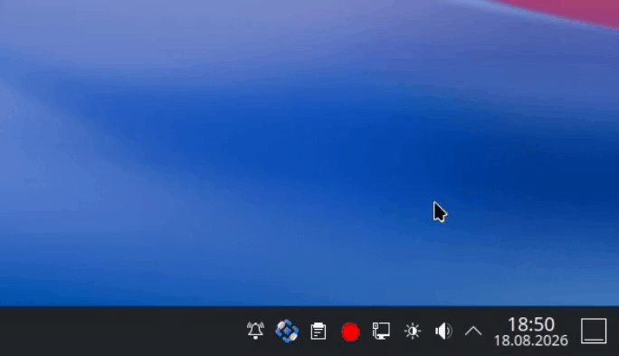

#  DPIGate

<!-- shields.io cannot read a private repo; version is static and CI uses GitHub's own badges until the repo is public. -->
[](LICENSE)
[](#quick-start)
[](../../releases)
[](../../actions/workflows/build.yml)
[](../../actions/workflows/linux.yml)

**Per-program DPI bypass for Windows and Linux.** A fork of
[GoodbyeDPI](https://github.com/ValdikSS/GoodbyeDPI) that applies bypass tricks
*only* to the programs you choose — browsers, Discord, whatever you list —
while every other connection passes through untouched.

One-click install, a system tray to control it, automatic DNS selection, and a
filter list you can edit while it runs. The Linux side is a native port of the
same C engine (NFQUEUE + raw sockets instead of WinDivert), not a wrapper.

---

## Demo

**Windows** — installer, tray menu, DNS switching and the per-program filter list.


**Linux** — graphical installer, GTK tray, and the same filter list hot-reloading.



---

## Why this fork

| Feature | Original | DPIGate |
|---|---|---|
| Per-program whitelist | No — all traffic processed | **Yes** via `--only-programs` |
| Hot-reload of the list | — | **Yes** — edits apply in ~2 s, no restart |
| One-click auto-startup | `.cmd` scripts | **Installer** + hidden logon task |
| System tray | None | **Yes** — edit filters, switch DNS, toggle, stop |
| DNS auto-detection | Manual `--dns-addr` | **Yes** — tests 5 servers, picks fastest non-poisoned |
| Hidden background run | Console window visible | **Hidden** |
| SNI DPI bypass | Manual `-5`/`-9` flags | **Auto** via a config variable |
| Linux support | Windows only | **Yes** — native NFQUEUE port, same gate |

---

## Quick start

### Windows

1. Download the setup installer from the [latest release](../../releases/latest).
2. Run the installer. Tick **Start automatically at logon** if you want it on every boot.
3. Done — a tray icon appears near the clock. Right-click it to edit the
   whitelist, switch DNS, or stop.
4. Restart any browser that was already open. Browsers keep their own DNS
   cache, so a site you tried before DPIGate started can keep pointing at the
   ISP's block page until the browser restarts.

To remove it: tray icon → **Uninstall**, or **Settings → Apps & features**.

> Everything is copied to `C:\Program Files\DPIGate`, so the downloaded
> installer can be deleted afterwards. Launching elevates through UAC —
> `goodbyedpi.exe` needs admin rights to load the WinDivert driver.
>
> Coming from GoodByeDPI-Plus (this project's earlier name)? Just run the new
> installer: it upgrades in place, keeps your filter list and settings, and
> stays in the existing `C:\Program Files\GoodByeDPI-Plus` folder. On Linux,
> `install.sh` moves your config and removes the old files.

### Linux

There is no prebuilt package — the binary is compiled on your machine, so start
by getting the sources:

```bash
git clone https://github.com/MSelmanSonmez/DPIGate.git
cd DPIGate/linux
```

Or download `dpigate-<version>-linux.tar.gz` from the
[latest release](../../releases/latest), unpack it, and `cd dpigate` —
same contents, no git needed.

**Graphical installer.** Double-click `install.sh` in your file manager, or run
it with no terminal attached, and the GTK wizard (`installer-gui.py`) opens:
**Welcome → License → Components → Ready → Installing → Finished**, with a live
install log and a "start after install" checkbox. Force it explicitly with:

```bash
./install.sh --gui
```

**Terminal installer.** The same steps without a GUI — the wizard runs this
underneath, so the two cannot drift apart:

```bash
sudo -v            # refresh the sudo timestamp first — avoids repeated prompts
./install.sh       # add --start to launch right away
```

Either way, start it afterwards from the application menu or with
`~/.local/share/DPIGate/start.sh`.

If anything ever looks wrong:
`~/.local/share/DPIGate/kill.sh` — it always restores connectivity.

> **Tested distributions.** Hands-on testing has been done on **Fedora, Ubuntu
> and Arch** only. The installer probes capabilities rather than package names,
> so other distributions are expected to work — CI runs its dependency and build
> check on nine of them — but they have not been verified in practice. Reports
> from other distros are welcome.

### Virtual machines: use a bridged adapter, not NAT

**The bypass does not work in a VM with NAT networking**, on either platform.
It is not a bug that can be fixed here: a NAT stack (VirtualBox's slirp,
and user-mode NAT in general) terminates the guest's TCP connection and
regenerates the stream on the host side, so the fragmentation, TTL and decoy
packets that defeat the DPI never leave the host as the guest sent them. The
DPI sees a perfectly ordinary connection and blocks it as usual.

Shut the VM down and switch Adapter 1 to a **Bridged Adapter**, so the guest
talks to the network directly. On Linux, `start.sh` detects VirtualBox NAT and
refuses to start rather than leave you debugging a bypass that cannot work;
`--force-nat` overrides the check if you want to run it anyway.

---

## How it works

DPIGate learns **which process owns each connection** and gates the
bypass on that. On Windows this comes from WinDivert's FLOW layer; on Linux from
`sock_diag` plus an inode→PID cache over `/proc`. The `(5-tuple → PID → exe)`
result is cached in a hash map.

The packet loop then checks that map for every TCP/UDP packet. On the whitelist →
bypass tricks (fragmentation, fake packets, TTL games) are applied. Not on it →
the packet is reinjected untouched, at zero cost. Existing connections are
seeded at startup, so open browser tabs are not missed, and a watcher thread
re-reads the filter list ~2 s after you save it.

DNS is handled separately: on Windows `--dns-addr` redirect is exempt from the
gate so the system resolver still works; on Linux the system resolver's upstream
is repointed at a clean server when the current one turns out to be poisoned.

---

## The system tray

Everything you need day to day is in the tray icon's right-click menu — you
should not have to touch a config file or a terminal.

| Menu item | What it does |
|---|---|
| **DNS: …** | Every candidate DNS server with its measured response time; the active one is marked. Click one to switch — the engine restarts with it in a second or two |
| **Auto-detect (re-test)** | Runs the DNS speed/poisoning test again and picks the best server. Useful after changing networks |
| **Edit Program Filters** | Opens your filter list in a text editor. Add or remove a program, save, and it applies in ~2 seconds — no restart |
| **Bypass All Traffic** | Toggle. On = ignore the filter list and bypass everything (useful when an app cannot be matched, e.g. a Flatpak/Snap sandbox). Off = only the listed programs |
| **Auto Start** | Toggle. Registers or removes the startup entry — a hidden scheduled task on Windows, an autostart entry plus a systemd user unit on Linux |
| **Uninstall** | Runs the uninstaller |
| **Exit** | Stops the engine and removes the icon. On Linux it also unloads the firewall rules, restoring normal networking |

Windows shows a warning balloon if the engine exits unexpectedly; on Linux a
watchdog checks every 2 seconds and tears the firewall rules down if the daemon
dies, so a crash can never leave you without a working connection.

Filter list locations: `C:\Program Files\DPIGate\programs.txt` on
Windows, `~/.config/DPIGate/ProgramFilters` on Linux. One program per
line, `#` for comments.

---

## Documentation

| Guide | Covers |
|---|---|
| [**Windows guide**](docs/windows.md) | tray, DNS auto-detection, configuration, filter syntax, building, installer, uninstall |
| [**Linux guide**](docs/linux.md) | architecture, requirements, install flags, tray, services, troubleshooting |

Added command-line arguments (both platforms):

```
--only-programs <txtfile>  Apply bypass tricks ONLY to programs listed in the
                            file (one basename or path substring per line).
--debug-proc               Print per-program gate decisions.
```

All original GoodbyeDPI arguments still work. Run `goodbyedpi -h` for the list.

---

## Repository layout

```
DPIGate/
├── README.md
├── LICENSE                     # Apache 2.0
├── NOTICE                      # Attribution & modified-files notice
├── docs/
│   ├── windows.md              # Windows guide
│   ├── linux.md                # Linux guide
│   ├── linux-port-notes.md     # Internal: original port design notes
│   └── vm-diagnostics.md       # Internal: maintainer VM runbook
├── gif/                        # Demo recordings
├── .github/workflows/
│   ├── build.yml               # CI: Windows x86 + x86_64 build
│   └── linux.yml               # CI: install.sh --check-only across 9 distros
├── windows/
│   ├── goodbyedpi.c            # Packet loop + per-program gate (--only-programs)
│   ├── proctrack.c/.h          # 5-tuple → PID → exe → whitelist tracker
│   ├── blackwhitelist.c/.h     # Host-based blacklist
│   ├── dnsredir.c/.h           # DNS redirect
│   ├── fakepackets.c/.h        # Fake packet generation
│   ├── ttltrack.c/.h           # TTL tracking
│   ├── service.c/.h            # Windows service helpers
│   ├── utils/                  # getline, repl_str, uthash
│   ├── Makefile
│   ├── start.ps1               # Launcher: DNS detection + tray + gate
│   ├── install.ps1             # Scheduled task installer
│   ├── uninstall.ps1           # Scheduled task uninstaller
│   ├── setup.iss               # Inno Setup installer script
│   ├── programs.txt            # Filter list (editable, hot-reloaded)
│   ├── x86_64/                 # 64-bit binaries + WinDivert
│   └── x86/                    # 32-bit binaries + WinDivert
└── linux/
    ├── goodbyedpi.c/.h         # Packet loop (pio_* API instead of WinDivert)
    ├── proctrack_linux.c/.h    # Gate: /proc/net + sock_diag + inode→PID cache
    ├── packet_io.h             # Packet I/O abstraction
    ├── packet_io_linux.c       # NFQUEUE backend (libnetfilter_queue)
    ├── rawsend_linux.c/.h      # Raw-socket fake packet injection + fwmark
    ├── checksum.c/.h           # IP/TCP/UDP checksums + parsing (RFC 1071)
    ├── fakepackets.c dnsredir.c ttltrack.c blackwhitelist.c utils/
    │                           # Ported bypass sources, shared with windows/
    ├── Makefile                # Build + check-sync/sync + test targets
    ├── install.sh              # Installer (text + graphical)
    ├── installer-gui.py        # GTK install wizard
    ├── uninstall.sh
    ├── start.sh                # Launcher: DNS check, firewall, daemon, tray
    ├── kill.sh                 # Emergency stop / teardown
    ├── reaper.sh               # Tears daemon + rules down if the tray is killed
    ├── tray.py                 # GTK tray
    ├── tray-launcher.sh        # Autostart wrapper (--check for diagnostics)
    ├── dns_detect.py           # DNS candidate testing / poisoning detection
    ├── goodbyedpi.nft          # nftables rules (table inet goodbyedpi)
    ├── goodbyedpi.service      # systemd unit
    ├── ProgramFilters          # Filter list (editable, hot-reloaded)
    ├── lib/                    # platform.sh portability layer, zenity wizard
    ├── service/                # OpenRC and runit service definitions
    ├── scripts/                # check-sync, sync, make-dist, settings-test
    └── *_test.c                # checksum / proctrack / rawsend / bypass / smoke
```

---

## Disclaimer

This software is provided for lawful use, for research, and for restoring access
to legitimate services. Circumventing network filtering may be restricted or
prohibited in some jurisdictions, and it may also violate the terms of service of
your network or internet provider.

**All legal responsibility arising from the use of this software rests entirely
with the person using it.** The authors and contributors provide it "as is",
without warranty of any kind, and accept no liability for any use, misuse, or
consequence of its use. Check your local laws before running it, and only use it
on networks you are authorised to use. See [LICENSE](LICENSE) for the full
warranty and liability disclaimer.

---

## Credits

- **[ValdikSS/GoodbyeDPI](https://github.com/ValdikSS/GoodbyeDPI)** — the original DPI circumvention utility this project forks.
- **[basil00/WinDivert](https://github.com/basil00/WinDivert)** — the packet capture/divert library behind the Windows build.
- **[keift/goodbyedpi](https://github.com/keift/goodbyedpi)** — inspiration for the one-click startup installer.
- **[bol-van/zapret](https://github.com/bol-van/zapret)** — reference for the NFQUEUE + raw-socket + fwmark approach used by the Linux port.

---

## License

Apache License 2.0 — see [LICENSE](LICENSE) and [NOTICE](NOTICE).

The core engine is derived from GoodbyeDPI, which is Apache-2.0. Apache-2.0 code
cannot be relicensed as MIT without dropping the patent grant and attribution
obligations that travel with every derivative work, so this fork stays Apache 2.0.
