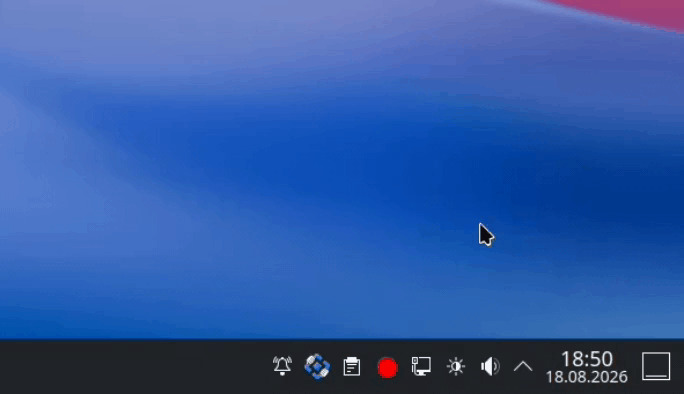

#  DPIGate

<!-- shields.io cannot read a private repo; version is static and CI uses GitHub's own badges until the repo is public. -->
[](LICENSE)
[](#quick-start)
[](../../releases)
[](../../actions/workflows/build.yml)
[](../../actions/workflows/linux.yml)
[](../../actions/workflows/macos.yml)

**Per-program DPI bypass for Windows and Linux, site-list bypass for macOS (experimental).** A fork of
[GoodbyeDPI](https://github.com/ValdikSS/GoodbyeDPI) that applies bypass tricks
*only* to the programs you choose — browsers, Discord, whatever you list —
while every other connection passes through untouched.

One-click install, a system tray to control it, automatic DNS selection, and a
filter list you can edit while it runs. The Linux side is a native port of the
same C engine (NFQUEUE + raw sockets instead of WinDivert), not a wrapper.
On macOS there are no per-program filters: the app sets the system proxy to a
local SOCKS5 proxy, and its Only Listed Sites option limits the bypass to the
domains in a site list.

---

## Demo

**Windows** — installer, tray menu, DNS switching and the per-program filter list.


**Linux** — graphical installer, GTK tray, and the same filter list hot-reloading.



---

## Why this fork

| Feature | Original | DPIGate |
|---|---|---|
| Per-program whitelist | No — all traffic processed | **Yes** via `--only-programs` |
| Hot-reload of the list | — | **Yes** — edits apply in ~2 s, no restart |
| One-click auto-startup | `.cmd` scripts | **Installer** + hidden logon task |
| System tray | None | **Yes** — edit filters, switch DNS, toggle, stop |
| DNS auto-detection | Manual `--dns-addr` | **Yes** — tests 5 servers, picks fastest non-poisoned |
| Hidden background run | Console window visible | **Hidden** |
| SNI DPI bypass | Manual `-5`/`-9` flags | **Auto** via a config variable |
| Linux support | Windows only | **Yes** — native NFQUEUE port, same gate |

---

## Quick start

### Windows

1. Download the setup installer from the [latest release](../../releases/latest).
2. Run the installer. Tick **Start automatically at logon** if you want it on every boot.
3. Done — a tray icon appears near the clock. Right-click it to edit the
   whitelist, switch DNS, or stop.
4. Restart any browser that was already open. Browsers keep their own DNS
   cache, so a site you tried before DPIGate started can keep pointing at the
   ISP's block page until the browser restarts.
5. To avoid those restarts, turn on secure DNS, either for the whole system
   (Windows 11: **Settings → Network & internet → your connection → DNS server
   assignment → Edit → Manual**, then a DNS server such as `1.1.1.1` with
   **DNS over HTTPS** on) or only in the browser (Chromium browsers:
   **Settings → Privacy and security → Security → Use secure DNS**; Firefox:
   **Settings → Privacy and security → DNS over HTTPS → Advanced settings →
   Custom protection**).

To remove it: tray icon → **Uninstall**, or **Settings → Apps & features**.

> Everything is copied to `C:\Program Files\DPIGate`, so the downloaded
> installer can be deleted afterwards. Launching elevates through UAC —
> `goodbyedpi.exe` needs admin rights to load the WinDivert driver.
>
> Coming from GoodByeDPI-Plus (this project's earlier name)? Just run the new
> installer: it upgrades in place, keeps your filter list and settings, and
> stays in the existing `C:\Program Files\GoodByeDPI-Plus` folder. On Linux,
> `install.sh` moves your config and removes the old files.

### Linux

There is no prebuilt package — the binary is compiled on your machine, so start
by getting the sources (an AppImage can also be built from them with
`linux/packaging/appimage/build-appimage.sh`. It either installs DPIGate or runs it
**without installing** — one password prompt, nothing left behind, settings next to the
AppImage; see the [Linux guide](docs/linux.md#appimage)):

```bash
git clone https://github.com/MSelmanSonmez/DPIGate.git
cd DPIGate/linux
```

Or download `dpigate-<version>-linux.tar.gz` from the
[latest release](../../releases/latest), unpack it, and `cd dpigate` —
same contents, no git needed.

**Graphical installer.** Double-click `install.sh` in your file manager, or run
it with no terminal attached, and the GTK wizard (`installer-gui.py`) opens:
**Welcome → License → Components → Ready → Installing → Finished**, with a live
install log and a "start after install" checkbox. Force it explicitly with:

```bash
./install.sh --gui
```

**Terminal installer.** The same steps without a GUI — the wizard runs this
underneath, so the two cannot drift apart:

```bash
sudo -v            # refresh the sudo timestamp first — avoids repeated prompts
./install.sh       # add --start to launch right away
```

Either way, start it afterwards from the application menu or with
`~/.local/share/DPIGate/start.sh`.

If anything ever looks wrong:
`~/.local/share/DPIGate/kill.sh` — it always restores connectivity.

> **Tested distributions.** Hands-on testing has been done on **Fedora, Ubuntu
> and Arch** only. The installer probes capabilities rather than package names,
> so other distributions are expected to work — CI runs its dependency and build
> check on nine of them — but they have not been verified in practice. Reports
> from other distros are welcome.

### Virtual machines: use a bridged adapter, not NAT

**The bypass does not work in a VM with NAT networking**, on either platform.
It is not a bug that can be fixed here: a NAT stack (VirtualBox's slirp,
and user-mode NAT in general) terminates the guest's TCP connection and
regenerates the stream on the host side, so the fragmentation, TTL and decoy
packets that defeat the DPI never leave the host as the guest sent them. The
DPI sees a perfectly ordinary connection and blocks it as usual.

Shut the VM down and switch Adapter 1 to a **Bridged Adapter**, so the guest
talks to the network directly. On Linux, `start.sh` detects VirtualBox NAT and
refuses to start rather than leave you debugging a bypass that cannot work;
`--force-nat` overrides the check if you want to run it anyway.

---

## macOS (experimental)

A menu bar app around a SOCKS5 proxy built on [ByeDPI](https://github.com/hufrea/byedpi). The packet-level tricks used on Windows and Linux (fake packets, TTL games) are not available on macOS, so only apps that honor the system proxy are covered. While DPIGate is on, the system proxy is always set. Safari and Chromium-based browsers follow it by default; Firefox must use "Use system proxy settings" (Settings → Network Settings), because with "No proxy" it bypasses DPIGate.

Tested on Intel macOS 13 (13.7.8); Apple Silicon builds are untested.

There is no Bypass All or Program Filters item on macOS: what gets the bypass is chosen with the site list (Only Listed Sites) instead.

### Install

Unpack the release zip and run the installer; it copies the app to `~/Applications` (no admin rights):

```sh
cd DPIGate-macos
./install.sh --open      # --open starts the app afterwards
```

From a source checkout (Command Line Tools are enough; `xcode-select --install`):

```sh
make -C macos app && macos/install.sh
```

The app is built as a universal binary (Intel and Apple Silicon), but only Intel has been tested. It is ad-hoc signed and not notarized, so macOS may block the first launch: right-click the app, Open (`install.sh` already removes the download quarantine flag; for a copy you moved by hand use `xattr -d com.apple.quarantine`). On macOS 15 Sequoia, right-click and Open is no longer enough: after the blocked launch, go to System Settings → Privacy & Security → Open Anyway. There is no Dock icon; look for the icon in the menu bar. Only one DPIGate app runs at a time: a second launch says so and quits.

### The menu

| Menu item | What it does |
|---|---|
| **Turn On / Turn Off** | Starts the proxy, sets DNS, flushes the DNS cache and points the system proxies at it, or undoes all of that. Each start of the proxy asks for an administrator password (the DNS cache flush needs it) |
| **DNS: …** | Candidate servers, measured in the background with one plain, unencrypted UDP query for discord.com; Auto-detect skips servers that answer with a poisoned address. Pick one or Auto-detect. A choice on port 53 also becomes the system DNS |
| **Only Listed Sites** | Applies the DPI tricks only to the domains in `sites.txt` (subdomains included; defaults to Discord's domains; off by default) and passes every other connection through unchanged |
| **Edit Site List** | Opens `sites.txt`; edits restart a running proxy within 2 seconds. New on macOS: the Linux tray has no such item (there the program filter does this job) |
| **Auto Start** | Toggle. A LaunchAgent starts the app at login; if you move the app, the entry is updated the next time it launches |
| **Uninstall** | Restores your settings and permanently deletes the app and its settings |
| **Open Log** | Opens the log |
| **Exit** | Stops the proxy and restores your settings |

If the app itself is killed (`kill -9`, a crash), the proxy keeps running; the next launch stops that leftover run, which restores your settings, and starts fresh. Turn Off and Exit send the script Ctrl-C, so your settings are restored; if it dies on its own the app restarts it (up to 3 times a minute).

### Uninstall

Use the menu item. If your saved network settings cannot be restored, Uninstall stops, tells you, and deletes nothing, so you can try again or run `dpigate restore`. If you cannot open the app, run `./uninstall.sh` (from the unpacked zip or `macos/`; `--yes` skips the question). It quits when DPIGate is running, restores a saved state, and deletes the app, its Auto Start entry and its settings.

### Command line

```sh
macos/dpigate run        # set DNS, flush the DNS cache, start the proxy, set system proxies; Ctrl-C undoes it
macos/dpigate restore    # put the saved settings back after a crash or kill -9
macos/dpigate status     # proxy state and current proxy/DNS settings
```

`make -C macos` builds only the proxy (`macos/build/dpigate-proxy`); `make -C macos dist` builds the release zip `macos/build/DPIGate-macos.zip`. `make -C macos test` runs all tests (fake script and tools; they touch no system setting). `make -C macos fuzz` runs a short ASan/UBSan fuzz of the DNS parser (about 10 seconds; CI runs it separately).

The proxy speaks SOCKS5 and HTTP CONNECT on the same port. `run` points the system SOCKS, web and secure web proxies at it and sets `HTTPS_PROXY`/`HTTP_PROXY` with `launchctl setenv`, so apps that ignore the system proxy (Discord's updater) are covered when started normally, e.g. from the Dock. Environment variables only reach apps launched afterwards: restart Discord after starting dpigate.

The proxy resolves names itself (plain UDP DNS, 1 s timeout, cached) so a stalled system resolver cannot freeze it. Its servers are the DNS chosen in the menu, or 1.1.1.1 then 1.0.0.1 when started without `DPIGATE_DNS`; `DPIGATE_DNS="ip ip"` sets them. The system DNS gets the same servers, but only the port-53 ones are taken (`DPIGATE_SYSTEM_DNS` overrides), so a Yandex entry on port 1253 leaves the system on 1.1.1.1 and 1.0.0.1.

`run` saves your previous proxy, environment and DNS settings in `~/Library/Application Support/DPIGate/state` and restores them on exit. The script never calls `sudo` itself. Flushing the DNS cache needs root, so every start of the proxy (Turn On, `run`, or a restart caused by a menu change) shows macOS's own password dialog, opened through `osascript`; restoring on exit does not ask. If you cancel it, `run` continues but the first page loads may be slow.

### Files

| File | Location |
|---|---|
| Settings | `~/Library/Application Support/DPIGate/config` |
| Site list | `sites.txt`, next to `config` |
| Saved settings (while running) | `~/Library/Application Support/DPIGate/state` |
| Log | `~/Library/Logs/DPIGate/dpigate.log` |
| Auto Start entry | `~/Library/LaunchAgents/org.dpigate.menubar.plist` |

### Known limitations

- Switching between Wi-Fi and Ethernet may not apply the proxy to the new network service. Turn DPIGate off and on again after switching.
- No Bypass All or Program Filters on macOS; selection is by site list only.
- Apple Silicon (arm64) builds are untested.
- Each restart of the proxy (turning on, changing DNS, toggling Only Listed Sites, saving the site list) asks for the administrator password.
- Not notarized, so the first launch needs the approval steps above.
- DNS measurement is plain UDP, not encrypted: port 53, and port 1253 for the Yandex candidate.

## How it works

DPIGate learns **which process owns each connection** and gates the
bypass on that. On Windows this comes from WinDivert's FLOW layer; on Linux from
`sock_diag` plus an inode→PID cache over `/proc`. The `(5-tuple → PID → exe)`
result is cached in a hash map.

The packet loop then checks that map for every TCP/UDP packet. On the whitelist →
bypass tricks (fragmentation, fake packets, TTL games) are applied. Not on it →
the packet is reinjected untouched, at zero cost. Existing connections are
seeded at startup, so open browser tabs are not missed, and a watcher thread
re-reads the filter list ~2 s after you save it.

DNS is handled separately: on Windows `--dns-addr` redirect is exempt from the
gate so the system resolver still works; on Linux the system resolver's upstream
is repointed at a clean server when the current one turns out to be poisoned.

---

## The system tray

Everything you need day to day is in the tray icon's right-click menu — you
should not have to touch a config file or a terminal.

| Menu item | What it does |
|---|---|
| **DNS: …** | Every candidate DNS server with its measured response time; the active one is marked. Click one to switch — the engine restarts with it in a second or two |
| **Auto-detect (re-test)** | Runs the DNS speed/poisoning test again and picks the best server. Useful after changing networks |
| **Edit Program Filters** | Opens your filter list in a text editor. Add or remove a program, save, and it applies in ~2 seconds — no restart |
| **Bypass All Traffic** | Toggle. On = ignore the filter list and bypass everything (useful when an app cannot be matched, e.g. a Flatpak/Snap sandbox). Off = only the listed programs |
| **Auto Start** | Toggle. Registers or removes the startup entry — a hidden scheduled task on Windows, an autostart entry plus a systemd user unit on Linux |
| **Uninstall** | Runs the uninstaller |
| **Exit** | Stops the engine and removes the icon. On Linux it also unloads the firewall rules, restoring normal networking |

Windows shows a warning balloon if the engine exits unexpectedly; on Linux a
watchdog checks every 2 seconds and tears the firewall rules down if the daemon
dies, so a crash can never leave you without a working connection.

Filter list locations: `C:\Program Files\DPIGate\programs.txt` on
Windows, `~/.config/DPIGate/ProgramFilters` on Linux. One program per
line, `#` for comments.

---

## Documentation

| Guide | Covers |
|---|---|
| [**Windows guide**](docs/windows.md) | tray, DNS auto-detection, configuration, filter syntax, building, installer, uninstall |
| [**Linux guide**](docs/linux.md) | architecture, requirements, install flags, tray, services, troubleshooting |

Added command-line arguments (both platforms):

```
--only-programs <txtfile>  Apply bypass tricks ONLY to programs listed in the
                            file (one basename or path substring per line).
--debug-proc               Print per-program gate decisions.
```

All original GoodbyeDPI arguments still work. Run `goodbyedpi -h` for the list.

---

## Repository layout

```
DPIGate/
├── README.md
├── LICENSE                     # Apache 2.0
├── NOTICE                      # Attribution & modified-files notice
├── docs/
│   ├── windows.md              # Windows guide
│   ├── linux.md                # Linux guide
│   ├── linux-port-notes.md     # Internal: original port design notes
│   └── vm-diagnostics.md       # Internal: maintainer VM runbook
├── gif/                        # Demo recordings
├── .github/workflows/
│   ├── build.yml               # CI: Windows x86 + x86_64 build
│   └── linux.yml               # CI: install.sh --check-only across 9 distros
├── windows/
│   ├── goodbyedpi.c            # Packet loop + per-program gate (--only-programs)
│   ├── proctrack.c/.h          # 5-tuple → PID → exe → whitelist tracker
│   ├── blackwhitelist.c/.h     # Host-based blacklist
│   ├── dnsredir.c/.h           # DNS redirect
│   ├── fakepackets.c/.h        # Fake packet generation
│   ├── ttltrack.c/.h           # TTL tracking
│   ├── service.c/.h            # Windows service helpers
│   ├── utils/                  # getline, repl_str, uthash
│   ├── Makefile
│   ├── start.ps1               # Launcher: DNS detection + tray + gate
│   ├── install.ps1             # Scheduled task installer
│   ├── uninstall.ps1           # Scheduled task uninstaller
│   ├── setup.iss               # Inno Setup installer script
│   ├── programs.txt            # Filter list (editable, hot-reloaded)
│   ├── x86_64/                 # 64-bit binaries + WinDivert
│   └── x86/                    # 32-bit binaries + WinDivert
├── macos/
│   ├── Makefile                # Proxy, menu bar app, release zip, test targets
│   ├── app/                    # Menu bar app (Swift): main.swift, Info.plist
│   ├── byedpi/                 # ByeDPI SOCKS5 proxy sources (MIT), see UPSTREAM
│   ├── dpigate                 # Run script: DNS, system proxy, state, restore
│   ├── install.sh              # Installer, no admin rights
│   ├── uninstall.sh
│   └── tests/                  # Shell and C tests, touch no system setting
└── linux/
    ├── goodbyedpi.c/.h         # Packet loop (pio_* API instead of WinDivert)
    ├── proctrack_linux.c/.h    # Gate: /proc/net + sock_diag + inode→PID cache
    ├── packet_io.h             # Packet I/O abstraction
    ├── packet_io_linux.c       # NFQUEUE backend (libnetfilter_queue)
    ├── rawsend_linux.c/.h      # Raw-socket fake packet injection + fwmark
    ├── checksum.c/.h           # IP/TCP/UDP checksums + parsing (RFC 1071)
    ├── fakepackets.c dnsredir.c ttltrack.c blackwhitelist.c utils/
    │                           # Ported bypass sources, shared with windows/
    ├── Makefile                # Build + check-sync/sync + test targets
    ├── install.sh              # Installer (text + graphical)
    ├── installer-gui.py        # GTK install wizard
    ├── uninstall.sh
    ├── start.sh                # Launcher: DNS check, firewall, daemon, tray
    ├── kill.sh                 # Emergency stop / teardown
    ├── reaper.sh               # Tears daemon + rules down if the tray is killed
    ├── tray.py                 # GTK tray
    ├── tray-launcher.sh        # Autostart wrapper (--check for diagnostics)
    ├── dns_detect.py           # DNS candidate testing / poisoning detection
    ├── goodbyedpi.nft          # nftables rules (table inet goodbyedpi)
    ├── goodbyedpi.service      # systemd unit
    ├── ProgramFilters          # Filter list (editable, hot-reloaded)
    ├── lib/                    # platform.sh portability layer, zenity wizard
    ├── service/                # OpenRC and runit service definitions
    ├── scripts/                # check-sync, sync, make-dist, settings-test
    └── *_test.c                # checksum / proctrack / rawsend / bypass / smoke
```

---

## Disclaimer

This software is provided for lawful use, for research, and for restoring access
to legitimate services. Circumventing network filtering may be restricted or
prohibited in some jurisdictions, and it may also violate the terms of service of
your network or internet provider.

**All legal responsibility arising from the use of this software rests entirely
with the person using it.** The authors and contributors provide it "as is",
without warranty of any kind, and accept no liability for any use, misuse, or
consequence of its use. Check your local laws before running it, and only use it
on networks you are authorised to use. See [LICENSE](LICENSE) for the full
warranty and liability disclaimer.

---

## Credits

- **[ValdikSS/GoodbyeDPI](https://github.com/ValdikSS/GoodbyeDPI)** — the original DPI circumvention utility this project forks.
- **[basil00/WinDivert](https://github.com/basil00/WinDivert)** — the packet capture/divert library behind the Windows build.
- **[keift/goodbyedpi](https://github.com/keift/goodbyedpi)** — inspiration for the one-click startup installer.
- **[bol-van/zapret](https://github.com/bol-van/zapret)** — reference for the NFQUEUE + raw-socket + fwmark approach used by the Linux port.
- **[hufrea/byedpi](https://github.com/hufrea/byedpi)** — the SOCKS5 proxy engine behind the macOS app (MIT).

---

## License

Apache License 2.0 — see [LICENSE](LICENSE) and [NOTICE](NOTICE).

The core engine is derived from GoodbyeDPI, which is Apache-2.0. Apache-2.0 code
cannot be relicensed as MIT without dropping the patent grant and attribution
obligations that travel with every derivative work, so this fork stays Apache 2.0.
